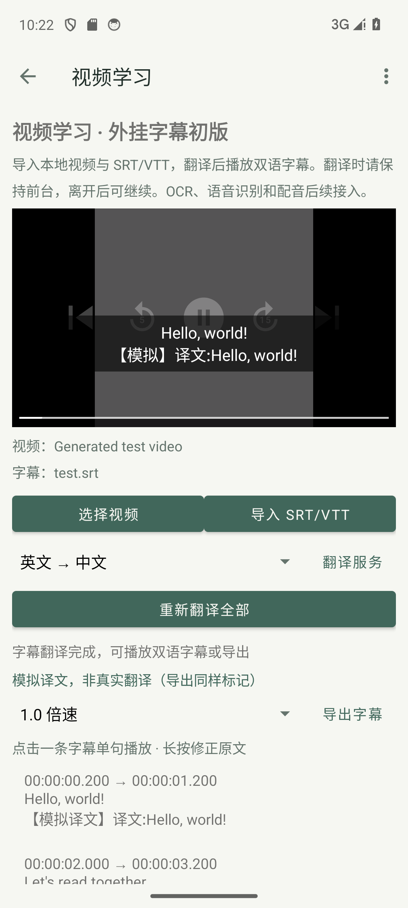

# 视频翻译第一阶段：外挂字幕

日期：2026-11-15。先完成共用字幕、翻译与输出链路；本轮未接 OCR、ASR、内嵌字幕提取、配音或视频合成。

## 如何使用

1. 从首页点击“视频学习 · 导入视频与字幕”。
2. 选择本地视频，再导入对应的 SRT/VTT。选择字幕可以先于视频；视频与字幕须属于同一版本，时间轴不会自动校正。
3. 选择英译中或中译英；“翻译服务”使用现有配置。模拟模式只验证流程，所有展示和导出均标记“非真实翻译”。
4. 点击“翻译 / 继续翻译”。在线模式确认发送地址和方向后，只发送字幕文本，视频不上传。
5. 双语字幕按播放位置叠加；点击列表中的一条字幕，从该条开始播放并在结束时间暂停，支持 0.75、1、1.25、1.5、2 倍速。单句播放隐藏控制条，轻点视频可重新显示控制条。
6. 长按字幕修正原文，时间轴不变，仅该条旧译文失效。处理期间先点取消，再修正。
7. 全部翻译后可导出双语或仅译文的 SRT/VTT；导出使用文件选择器，不直接覆盖原字幕。完成后的翻译按钮变为“重新翻译全部”，在线重译须再次确认。

同一服务、方向和字幕场景下重试跳过已完成片段；模拟与在线、不同地址和方向不共用译文。切换服务在下一次确认翻译时清除旧译文。翻译过程中离开页面或切后台会取消，已完成片段可继续；旋转保留 ViewModel，不自动重发。

视频 URI 使用系统文件授权，字幕原文、译文、provider/model 和播放位置原子保存在应用私有的 `video-project.json`，与书籍 Room 数据和章节翻译任务分离。初版只保存一个项目；切换到另一视频或替换字幕前有确认提示，请先导出需要保留的译文。保存采用防抖和离开时检查点，强制杀进程可能丢失最后不足一秒的最新更新。文件被移动、删除或授权失效后需重新选择。

## 字幕输入范围

- UTF-8（可带 BOM）或带 BOM 的 UTF-16，最大 2 MB、5000 条，单条最大 40000 个 Unicode 码点。
- SRT 的 `HH:MM:SS,mmm`；VTT 的 `HH:MM:SS.mmm` 或 `MM:SS.mmm`，毫秒精度。
- 支持多行、相同时刻的重叠字幕、按起始时间排序；去除常见文字样式、说话人标签，保留可见文字和起止时间。
- 忽略 WebVTT NOTE/STYLE/REGION，不保留 CSS、位置或字体；带 `X-TIMESTAMP-MAP` 的流式 VTT 明确拒绝，不猜测媒体时间。不是完整的 WebVTT/ASS 排版解析器。
- 空白文本、坏时间轴、倒置范围、超限和乱码会显示错误，不截断或自行编造时间。超长字幕按最多 4000 码点拆分请求，源字幕与原时间轴仍完整保存。
- 字幕导出要求全部译文完成，避免悄悄丢失未翻译片段。模拟译文在每个导出片段添加明确标记。

自编测试字幕：[sample.srt](video-fixtures/sample.srt)、[sample.vtt](video-fixtures/sample.vtt)。它们匹配从 0.2 到 3.2 秒的示例时间轴，不承诺匹配任意真实视频。

## 模块与接口

| 文件 | 职责 |
| --- | --- |
| `video/SubtitleSegment.java` | 不可变的统一片段：ID、毫秒时间轴、原文、译文、SUBTITLE/OCR/ASR 来源、可空置信度、provider/model |
| `video/TimedTextSource.java` | 文本获取边界；后续 OCR/ASR 返回同一片段模型 |
| `video/SubtitleCodec.java` | SRT/VTT 解析、文本清理和字幕导出 |
| `video/SubtitleTranslator.java` | 共用翻译适配、长文本拆分、ID/hash 校验、逐条进度、取消与跳过完成项 |
| `video/VideoProject.java`、`VideoProjectStore.java` | 单个视频项目、原子私有存储 |
| `viewmodel/VideoViewModel.java` | 导入、服务快照、后台线程、请求代次隔离、检查点与导出 |
| `ui/video/VideoFragment.java` | Media3 播放、字幕叠加、列表定位、编辑、倍速与文件选择器 |

Java 路径均以 `app/src/main/java/com/example/bilingualreader/` 为根。Media3 固定为 1.5.1，兼容本项目现有 compileSdk 35，不改动整个项目的 SDK 配置。实际能解码的视频格式取决于设备，MP4/H.264 作为初版验收输入。

批次契约增加可选 `Purpose.SUBTITLE`，保留旧构造函数并默认 `GENERAL`。视频使用与首页选词相同的独立服务绑定，但每次只发送一项，以兼容现有 `IsolatedSelectionTranslationService`。阅读页选词的 context 不用于字幕。

网关仍为原来的 `POST /translate`，新增可选 `profile: "subtitle"`。Qwen 按字幕场景使用简洁口语指令，并在响应中以 `subtitle: true` 确认能力；旧网关不能静默忽略新场景。普通小说、首页查询及语境请求的默认行为保留。没有上传视频接口或伪装可用的视频异步任务。

现有云端已部署更新，备份 `/opt/bilingualreader/app/gateway.before-video-20261115.py`；`/health` 新增 `subtitleProfile: true`。服务器密钥位置不变，APK 不包含百炼密钥。

## 验证与限制

- Debug、测试 APK、Release Java 编译通过；JVM 68 项通过（原 53 + 字幕流水线 13 + 字幕 HTTP 能力确认 2）。
- 后端 15 项通过，包含字幕场景的双向指令、非法场景拒绝、旧默认指令及原有语境回归。
- Pixel_6 API 34 完整回归 16 项通过，0 跳过，34.278 秒：视频 4 + 首页/选词/定位/发音 12。
- 随后修复控制条遮挡及字幕末尾换行导致双语导出意外分段的问题，补跑全部 68 项 JVM 测试和视频专项 4 项（15.203 秒）通过；设备用例实际将导出的 VTT 再解析，确认两条字幕均完整保留。
- 视频专项用例使用 MediaCodec 在设备生成四秒 H.264 文件，验证实际解码播放、双语叠加、单句句末暂停、VTT 导出标记、模拟转在线的缓存隔离、主动重译、私有检查点、旋转不重发，以及取消后的迟到响应不会覆盖续译。
- Lint 0 错误，104 警告，未禁用检查；`git diff --check` 通过。
- 云端用四条自编短句检查字幕两个方向及普通/语境兼容，实际 provider 为 qwen-mt、模型 qwen-mt-plus，原始结果见 [云端样本](video-stage1-cloud-results-2026-11-15.json)。这不是完整字幕语料质量测评，跨字幕语境和专有名词一致性仍需后续改善。
- 本轮未检测到实体手机，没有在用户手机安装或完成真机验收。模拟器内的“在线”隔离测试使用受控服务；真实云端验证由本机 HTTPS 发起，未上传任何视频、私人书籍或真实字幕素材。

截图仅包含生成的测试视频与明确标记的模拟译文：

## 后续阶段

先接无字幕视频的云端音频提取和带时间戳 ASR，增加异步任务、取消及阶段检查点；再实现字幕区域选择、视频抽帧、OCR 去重和时间定位。二者实现 `TimedTextSource` 或对应的远端结果映射后复用已有片段、翻译、播放和导出。内嵌文本字幕提取可作为第三个文本源。最后增加 TTS 音频生成、时长对齐和混音输出。本轮没有宣称这些能力已完成。
